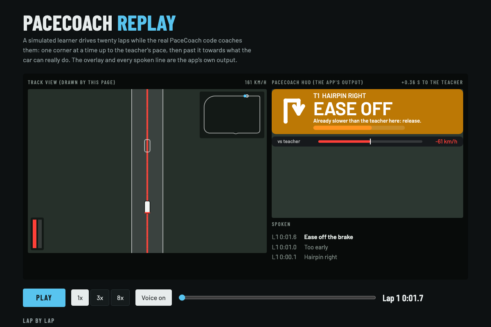

# PaceCoach

A co-driver and live driving coach for Assetto Corsa. It is made for people who
are new to sim racing and do not know the tracks yet.

**From the first second, with nothing to set up:**

- **Calls every corner** before you get there, on screen and by voice:
  "tight right", "hairpin left", "fast left, then right".
- **Tells you when to brake.** The cue adapts to your speed: arrive slower and
  it comes later.
- **Shows a track map** with numbered corners, coloured by how sharp they are.
- **Explains your mistakes** in plain language: locked brakes, wheelspin,
  understeer, running off the track, coasting, and more.
- **Records your laps** and keeps your best one.

**Once it has a teacher lap** (see "Getting a teacher" below):

- **Coaches you through the corner while you drive it.** It compares you with
  the teacher at the same spot on the track, many times a second, and speaks
  up while there is still time to act: "brake harder", "ease off the brake",
  "too early", "turn in", "wait", "full throttle", "move left".
- **Gives you one thing to fix at a time.** After a lap or two it picks the
  corner that costs you most, says what to change ("Brake about 15 m later"),
  reminds you as you arrive there, and tells you how the attempt went. When
  the corner is sorted it moves on to the next one.
- **Real targets for every corner**: which gear and how slow, shown on the
  card before you arrive, and a speed bar against the teacher at all times.
- **A driving line on the track**, red where the teacher brakes and green
  where it is on full throttle.
- **Does not stop when you beat the teacher.** From then on it coaches you
  against the **limit lap**: the fastest lap along your own line that the
  car's grip, as seen so far, allows. When no time is being lost any more it
  sends you looking for more grip, one corner at a time, and the limit moves
  up when you find it.
- **Keeps score of your progress**: a pace level from Rookie to On the limit,
  skill scores for braking points, corner speed, exits, line and consistency,
  five training steps to tick off, your ideal lap, and a line per session so
  you can see the trend over days.

**And it keeps itself up to date**: it fetches new versions from this
repository by itself.



*A frame from a replay of a simulated session. The overlay on the right is
what the app drew; the track view is a stand-in for the game.
`tools/make_replay.sh` builds the page.*

> **Status (0.6.0): early release.** The logic is covered by automated tests,
> and the whole app runs against a stand-in for the game. In that simulation
> a learner who starts 3.7 s off the teacher beats it on lap 12 and is within
> 0.3% of what the simulated car can really do after 45 laps. That shows the
> coaching logic holds together; it says nothing yet about a human driver.
> The app has had very little time in the real game. Expect rough edges, and
> please report them with the Diagnostics screenshot described below.

## What you need

- Assetto Corsa on PC, with **Content Manager** and **Custom Shaders Patch
  (CSP)**. Use a recent CSP version. The app checks what it needs at start-up
  and tells you if something is missing.

## Install

### The easy way

1. Download this repository (green **Code** button, **Download ZIP**) and
   unpack it anywhere.
2. Close the game. Open the `install` folder and double-click
   **Install PaceCoach.bat**.

The installer finds your Assetto Corsa folder through Steam (or asks for it),
moves any older PaceCoach folders out of the way, and copies the app in under
the one name the game accepts. It also adds **PaceCheck**, a tiny app that
reports what is wrong if PaceCoach will not start. `install/install.ps1` is
short and says exactly what it does. It is new and has not been proven on
other people's PCs yet; if it stops with a message, install by hand.

**Update PaceCoach from GitHub.bat** in the same folder does the same with the
newest version from this page, without you downloading anything first.

### By hand

1. Copy the whole folder into `assettocorsa\apps\lua\` and name it
   `PaceCoach`, so that you end up with
   `assettocorsa\apps\lua\PaceCoach\manifest.ini`.
   The folder name matters: CSP runs the Lua file named after the folder.
   `PaceCoach` works, and so does `PaceCoach-main` (what GitHub's ZIP unpacks
   to). Any other name will not start, and neither will a folder nested
   inside another folder. Delete older copies first.
2. Start any session. Move the mouse to the right edge of the screen to open
   the app bar and click **PaceCoach**. Open **PaceCoach Panel** too, and
   **PaceCoach Map** if you want the map on screen while driving.
3. Drag the windows where you want them. The HUD scales with its width.

Keep the main PaceCoach window open while you drive: recording runs with it.

## Updates

A few seconds after it starts, the app asks this repository whether there is a
newer version. If there is, it downloads the files that changed, checks every
one of them against the published size and checksum, and installs them the
next time the car stands still. The new version is used from the next time
you start the game. A note on the HUD tells you when that happened.

- It talks to `raw.githubusercontent.com` only: one small request per session
  to look, and more only when there is something to download.
- If anything about a download looks wrong, nothing is installed.
- **Panel → Settings → Updates** has both switches (look for updates;
  install without asking), the current state, and **Check for updates** /
  **Update now** buttons.
- If your CSP build cannot download files, the panel says so; use
  **Update PaceCoach from GitHub.bat** instead.

## Getting a teacher

The teacher is the fastest clean lap of another car of the **same model** as
yours. The easiest source is the game's own AI:

1. In Content Manager, set up a **Weekend, Race or Track Day** on your track.
2. Add **one to three AI opponents in the same car as you**. A strength
   around 90 to 100% works well.
3. Drive. The app records their laps in the background. After one or two of
   their laps you will see and hear **"Teacher lap recorded"**.

The teacher is saved per car and track, so you only need to do this once. In
later sessions, including solo practice, it is there from the first corner.
If an AI driver later sets a faster clean lap, it replaces the old one.

**Panel → Teacher** shows which benchmark is in use, your gap to it, your last
pass through every corner, and the target for every corner.

If you beat the teacher, the limit lap becomes the benchmark (see "Past the
teacher" below). Without any teacher, the coach works against the limit lap
built on your own best lap as soon as you have one: it asks every corner for
the grip you showed in your best one. The brake cue stays with the cautious
estimate until there is a teacher.

### A lap from a faster friend

If a friend uses PaceCoach with the same car and track, they can send you
their lap file from `Documents\Assetto Corsa\PaceCoach\`. Put it in the same
folder on your PC and change the ending of its name from `.txt` to
`.teacher.txt`. The faster of that lap and the AI lap is used.

## First run checklist

Pick an original Kunos track and a slow car.

**Part 1: on your own (about 10 minutes)**

1. **Panel → Diagnostics.** The self-test should say all checks passed. The
   live values (speed, throttle, brake, position) should change as you drive.
2. **Panel → Track.** The map should look like the track. Check that the
   number of corners and their directions match what you see from the car.
3. **Drive a calm lap.** Before each corner you should see the card and hear
   the direction, then "brake".
4. **Lock the brakes once and put four wheels off once.** A tip should appear
   for each.
5. **Finish one clean lap.** You should see "Reference lap saved". Leave the
   session, come back with the same car and track, and the best lap should
   still be listed under **Panel → Laps**.

**Part 2: with a teacher (about 10 minutes)**

6. Start a session with one to three AI opponents in the same car.
   **Panel → Teacher** should say it is watching that many cars.
7. After their first full lap or two you should get "Teacher lap recorded".
   The card should now show a gear and a speed for each corner, and a thin
   speed bar should appear under it.
8. Drive two laps. You should hear "turn in" at the main corners, and a live
   cue such as "ease off the brake" when you are well off the teacher's
   pace. After each corner a line of feedback should appear, and a coloured
   line should lie on the track ahead of you.
9. At the end of a lap the note should name your biggest loss and a focus
   corner. **Panel → Coach** should show the same focus, your skill scores
   and the training steps.

If something is wrong, send two things: a screenshot of **Panel →
Diagnostics**, and the last lines of
`Documents\Assetto Corsa\logs\custom_shaders_patch.log`.

### Quick fixes

| What you see | What to do |
|---|---|
| The app is in the list but its windows stay empty | The game is not running the app's code, which nearly always means the folder is named wrong, nested, or an older copy is still there. Run the installer (see Install), or open **PaceCheck** from the app bar and send a screenshot of it. |
| Left and right are the wrong way round | Panel → Settings → "Swap left and right" |
| No voice | Panel → Settings → "Test the voice". Check Diagnostics for the voice status. The on-screen card works without sound. |
| "This track has no ideal line" | The track has no AI line (some mod tracks). Lap recording and mistake tips still work; corner callouts and coaching cannot. |
| Brake cue feels far too early (no teacher yet) | Normal at first: the app starts cautious and trusts the car more as it sees you corner and brake harder. A teacher lap fixes this properly. |
| Brake cue feels too late or too early (with a teacher) | Change "Brake cue earlier by" in Settings. |
| Corners are called too early or too late | Panel → Settings → "Call corners ... before braking". Lower is later. |
| The coach talks too much | Panel → Settings: switch off "turn in", the line advice, praise, or all live coaching. The beginner HUD already limits it to two cues per corner. |
| No teacher appears | The AI cars must be the same model as yours, and one of them has to finish a clean lap without visiting the pits. Panel → Teacher shows how many cars are being watched. |
| No line on the track | Panel → Teacher shows the line's status. If it reports an error, send it to me; the rest of the app is unaffected. Meanwhile the game's own "Ideal line" assist is a good substitute. |
| "Update failed" in Settings | Nothing was changed. Try "Check for updates" again later, or run **Update PaceCoach from GitHub.bat**. |

## Reading the HUD

- **Arrow and words**: the next corner, its direction and how sharp it is.
  From sharpest to gentlest: hairpin, tight, medium, fast, kink.
- **Big number**: distance to where the corner starts.
- **EXIT**: you are still on the way out of this corner. The co-driver stays
  with it, shows the next corner as a small preview, and only calls it once
  you are out. If braking for the next one is very close it speaks anyway.
- **After a mistake** (a slide, a lock-up, four wheels off) it keeps quiet
  until you have the car back, then calls the corner ahead again.
- **Second line**: with a teacher, the gear and the slowest speed to aim for.
- **Bar**: fills up as you approach the brake point. When the card turns red
  and says **BRAKE**, brake. If you are already braking it does not nag.
- **FOCUS strip** under the card: the one instruction for this corner, while
  it is the corner you are working on.
- **Speed bar** ("vs teacher"): your speed against the teacher's at this
  exact point. Green to the right means faster, red to the left slower.
- **Card below**: one thing at a time. After a mistake, what happened and
  why. Just past each corner's exit, the time lost there and the main cause.
  At the end of a lap, your biggest loss and what to work on next.

### What the coach says while you drive

The card changes colour and shows the cue, with one line of reason under it.

| Cue | When | What to do |
|---|---|---|
| **BRAKE HARDER** | You are braking, but too gently to make the corner at this speed | Press harder now |
| **EASE OFF** | Still braking although you are already well under the teacher's speed | Release the brake and let the car roll in |
| **TOO EARLY** | On the brakes long before the teacher's brake point | Come off, and wait for the "brake" call |
| **NO BRAKE** | Braking for a corner the teacher only lifts for | Just lift off the throttle |
| **TURN IN** | You are reaching the teacher's turn-in point | Turn now, one smooth movement |
| **WAIT** | On the throttle mid-corner, before the teacher | Hold on until the car is turned |
| **FULL THROTTLE** | The exit is open and you are not flat out | All the way down |
| **STAY FLAT** | Lifting on a straight where the teacher is still flat out | Keep it down until the brake call |
| **MOVE LEFT / RIGHT** | More than 2.5 m off the teacher's line on the way to a corner | Use the road |

It never says more than two of these per corner on the beginner HUD (three
otherwise, "turn in" not counted), leaves a pause between them, and says
nothing at all while you are sorting out a slide.

Beginner mode (the default) shows only the above. Switch it off in Settings
to add the delta to your best lap and to the teacher, and two pairs of pedal
bars: yours on top, the teacher's below, red for brake and green for throttle.

Without a teacher, the brake point and corner speeds are **estimates** worked
out from the shape of the track and the grip the app has seen so far. They are
deliberately cautious.

## The lesson plan

**Panel → Coach** is the page to open in the pits.

- **Focus corner.** The corner with the biggest typical loss over your last
  three passes, and its most common cause. One bad pass does not count for
  much. The instruction moves in steps: a brake point that is 60 m too early
  is moved 25 m at a time, not all at once.
- **How a focus ends.** Two good passes in a row and the corner is "sorted";
  the coach names the next one. "Good" is judged over the whole stretch from
  the straight before to the straight after, so a slow exit cannot hide.
  After five tries with no progress the corner is put aside for a while.
- **How to do it.** Under the instruction are two or three lines on the
  technique, and a **speed trace** of your last pass through the focus corner
  against the benchmark, with the braking of both marked underneath.
- **Same thing every lap.** When no corner is losing much but your brake
  point in one of them moves around by more than 15 m from lap to lap, that
  becomes the lesson: pick a marker and use it. Being repeatable comes before
  being faster.
- **Training steps**, in the order a beginner should take them: stay on the
  track, brake at the right place, carry the speed, get on the power, be
  consistent. Each shows how far along you are.
- **Skills**: five scores from 0 to 100 against the teacher.
- **Ideal lap**: the best you have driven through every part of the track,
  added up. It is a lap you have already driven, only not in one go.
- **Where the time goes**: every corner, biggest typical loss first.
- **Sessions**: one line per session with this car and track.

## The session report

After every lap the app writes the session up as plain text in
`Documents\Assetto Corsa\PaceCoach\<track>__<car>.report.txt`: laps, best
lap, benchmark, pace level, the focus corner, where the time goes, skills,
what the coach said, mistakes, the grip it has seen, and anything the game
build is missing. Panel → Coach shows the exact path. It is the file to send
when you want a second opinion on your driving, or when something looks
wrong.

## Past the teacher

The AI is a decent driver, not a great one. Once your best lap is faster than
every real lap the app has, it stops comparing you with a lap somebody drove
and builds one instead.

- **The limit lap** follows the line of your own best lap. Its speed comes
  from the most cornering, braking and acceleration this car has been seen to
  produce: by the teacher, by a friend's lap, and by the grip meter while you
  drive. Braking and turning share the tyre, so it brakes into the corner the
  way a fast driver does. It is never slower than your real lap anywhere, and
  never more than 8% faster at any point.
- **"Find the limit."** When no corner is losing time against it, the coach
  picks a corner and asks for a little more: brake a touch later, carry a
  little more speed. Two tries, then the next corner.
- **The limit moves.** Corner harder than anything seen before and the limit
  lap rises in every corner of that speed range, which gives the coach new
  losses to work on. The ladder has no top rung you can stand on.
- **Trail braking.** When the benchmark keeps the brake on into the corner
  and you let go early, the feedback says so.
- **Pace level** (Panel → Coach): your best lap as a share of the limit lap.
  Rookie, Novice (within 10%), Club racer (6%), Front runner (3%), Expert
  (1.5%), On the limit (0.5%).

What this is not: a world record. The limit lap only knows the grip somebody
has actually shown in this car. To be measured against a truly fast driver,
drop their lap file in (see "A lap from a faster friend"); the limit is then
built from their grip too.

## How to practise with it

A plan for your first sessions. Stay on one car and one track: a slow,
forgiving car (for example the Abarth 500 or the BMW M3 E30) on a short track
(for example Magione or Vallelunga Club). Get a teacher lap early.

1. **Learn where the track goes.** Drive slowly. Listen to the calls and look
   as far ahead as you can. Goal: three clean laps in a row (training step 1).
2. **Do what the focus says, and only that.** One corner, one change. Leave
   the rest of the lap alone until the coach moves on.
3. **Brake in a straight line.** Brake when the cue comes, firmly, with the
   wheel straight. Ease off the pedal as the car slows. If you hear "too
   early" or "ease off", you are giving time away before the corner.
4. **Slow in, fast out.** Finish your braking, turn at "turn in", wait until
   you can see the exit, then squeeze the throttle as you straighten the
   wheel. Goal: no "wait", no "full throttle".
5. **Use all the road.** Start each corner from the outside edge, touch the
   inside at the middle, and let the car run back to the outside on the way
   out. Follow the line on the track and listen for "move left / right".
6. **Be consistent.** Three laps within half a second of each other is the
   last training step. Then look at "Where the time goes" and start again
   from the top of that list.

Two habits that help more than anything else: look where you want to go, not
at the bonnet, and change one thing at a time.

## Settings

Panel → Settings.

- **Beginner HUD**: one thing at a time. Off adds deltas and pedal bars.
- **Show mistake tips**: also covers the feedback after each corner.
- **Spoken corner callouts**, **Sound at the brake cue**,
  **Beep instead of "brake"**, **Say "throttle"**, **Volume**.
- **Live coaching while I drive**, **Say "turn in"**,
  **Say "move left / right"**, **Focus corner**, **Tell me when a corner
  goes well**.
- **Brake cue earlier by**: extra warning time, 0 to 1 second.
- **Call corners ... before braking**: how early a corner is announced,
  2 to 6 seconds.
- **Driving line on the track**, **Pedal bars on the advanced HUD**,
  **Speed bar against the benchmark**.
- **I use a gamepad**: turns off the steering-smoothness check.
- **Speeds in mph**.
- **Swap left and right**: only if callouts are mirrored.
- **Updates**: see above.

Your laps and your history are saved in `Documents\Assetto Corsa\PaceCoach\`,
a few small files per car and track. Updating or reinstalling the app does
not touch them.

## For tinkering

The `tests`, `tools`, `install` and `extras` folders are not used by the
game. With LuaJIT installed:

```
luajit tests/run.lua            # logic tests
luajit tests/smoke.lua          # whole app against a stand-in for the game
luajit tests/story.lua 45       # prints what the coach says to a simulated learner, lap by lap
tools/make_replay.sh out.html   # the same session as a page you can watch (needs ffmpeg, python3)
tools/make_voice.sh [voice]     # regenerate the voice clips (macOS)
luajit tools/make_update.lua "what is new"   # refresh update.txt before a commit
```

`update.txt` is the list the in-app updater reads. The tests fail when it does
not match the files, so it cannot be forgotten. Every threshold lives in
`src/config.lua`. All on-screen text is in `src/strings.lua`. Only
`src/sim.lua` reads game state.

## License

MIT. See [LICENSE](LICENSE).
