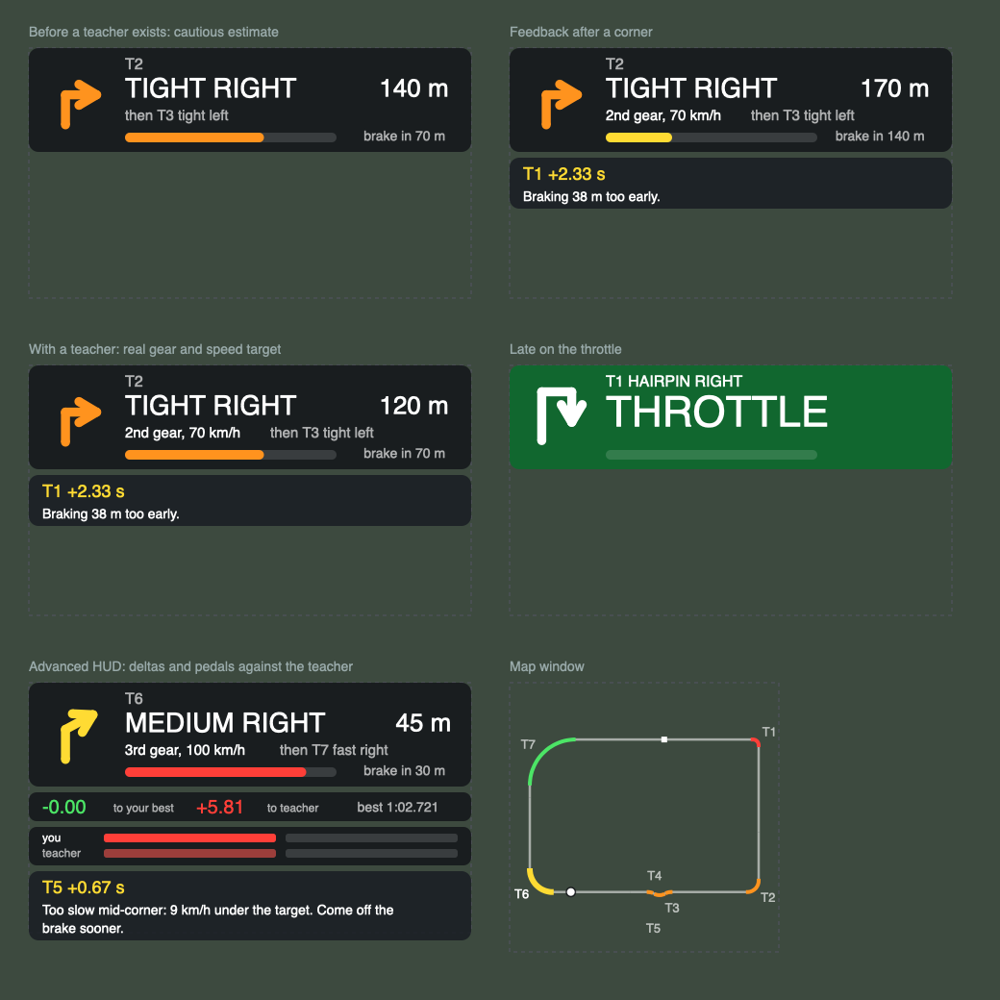

# PaceCoach

A co-driver and driving coach for Assetto Corsa. It is made for people who are
new to sim racing and do not know the tracks yet.

**From the first second, with nothing to set up:**

- **Calls every corner** before you get there, on screen and by voice:
  "tight right", "hairpin left", "fast left, then right".
- **Tells you when to brake.** The cue adapts to your speed: arrive slower and
  it comes later.
- **Shows a track map** with numbered corners, coloured by how sharp they are.
- **Explains your mistakes** in plain language: locked brakes, wheelspin,
  understeer, running off the track, coasting, and more.
- **Records your laps** and keeps your best one.

**Once it has a teacher lap** (see "Getting a teacher" below):

- **Real targets for every corner**: which gear and how slow, shown on the
  card before you arrive.
- **Brake and throttle cues from the teacher's own driving**, still adapted to
  your speed.
- **Feedback after every corner**: how much time you lost there and the one
  thing that cost it, for example "T3 +0.31 s, braking 25 m too early".
- **A driving line on the track**, red where the teacher brakes and green
  where it is on full throttle.



*A sketch of the HUD drawn outside the game. Fonts in the game will differ.*

> **Status (0.3.1): early release.** The logic is covered by automated tests
> and the whole app runs against a stand-in for the game, but it has had very
> little time in the real one. Expect rough edges, and please report them
> with the Diagnostics screenshot described below.

## What you need

- Assetto Corsa on PC, with **Content Manager** and **Custom Shaders Patch
  (CSP)**. Use a recent CSP version. The app checks what it needs at start-up
  and tells you if something is missing.

## Install

1. Copy the whole `PaceCoach` folder into `assettocorsa\apps\lua\`
   so that you end up with `assettocorsa\apps\lua\PaceCoach\manifest.ini`.
   The folder name matters: CSP runs the Lua file named after the folder.
   `PaceCoach` works, and so does `PaceCoach-main` (what GitHub's
   "Download ZIP" button gives you). Any other name will not start, and
   neither will a folder nested inside another folder.
2. Start any session. Move the mouse to the right edge of the screen to open
   the app bar and click **PaceCoach**. Open **PaceCoach Panel** too, and
   **PaceCoach Map** if you want the map on screen while driving.
3. Drag the windows where you want them. The HUD scales with its width.

Keep the main PaceCoach window open while you drive: recording runs with it.

## Getting a teacher

The teacher is the fastest clean lap of another car of the **same model** as
yours. The easiest source is the game's own AI:

1. In Content Manager, set up a **Weekend, Race or Track Day** on your track.
2. Add **one to three AI opponents in the same car as you**. A strength
   around 90 to 100% works well.
3. Drive. The app records their laps in the background. After one or two of
   their laps you will see and hear **"Teacher lap recorded"**.

The teacher is saved per car and track, so you only need to do this once. In
later sessions, including solo practice, it is there from the first corner.
If an AI driver later sets a faster clean lap, it replaces the old one.

**Panel → Teacher** shows which benchmark is in use, your gap to it, your last
pass through every corner, and the target for every corner.

If you beat the teacher, your own best lap becomes the benchmark.

### A lap from a faster friend

If a friend uses PaceCoach with the same car and track, they can send you
their lap file from `Documents\Assetto Corsa\PaceCoach\`. Put it in the same
folder on your PC and change the ending of its name from `.txt` to
`.teacher.txt`. The faster of that lap and the AI lap is used.

## First run checklist

Pick an original Kunos track and a slow car.

**Part 1: on your own (about 10 minutes)**

1. **Panel → Diagnostics.** The self-test should say all checks passed. The
   live values (speed, throttle, brake, position) should change as you drive.
2. **Panel → Track.** The map should look like the track. Check that the
   number of corners and their directions match what you see from the car.
3. **Drive a calm lap.** Before each corner you should see the card and hear
   the direction, then "brake".
4. **Lock the brakes once and put four wheels off once.** A tip should appear
   for each.
5. **Finish one clean lap.** You should see "Reference lap saved". Leave the
   session, come back with the same car and track, and the best lap should
   still be listed under **Panel → Laps**.

**Part 2: with a teacher (about 5 minutes)**

6. Start a session with one to three AI opponents in the same car.
   **Panel → Teacher** should say it is watching that many cars.
7. After their first full lap or two you should get "Teacher lap recorded".
   The card should now show a gear and a speed for each corner.
8. Drive a lap. After each corner a line of feedback should appear, and a
   coloured line should lie on the track ahead of you.

If something is wrong, send two things: a screenshot of **Panel →
Diagnostics**, and the last lines of
`Documents\Assetto Corsa\logs\custom_shaders_patch.log`.

### Quick fixes

| What you see | What to do |
|---|---|
| The app is in the list but its windows are empty | Check the folder name (see Install). Then open **PaceCoach Panel**: since 0.3.1 any start-up or drawing error is written in the window itself. Send me that text, or the lines mentioning PaceCoach in `Documents\Assetto Corsa\logs\custom_shaders_patch.log`. |
| Left and right are the wrong way round | Panel → Settings → "Swap left and right" |
| No voice | Panel → Settings → "Test the voice". Check Diagnostics for the voice status. The on-screen card works without sound. |
| "This track has no ideal line" | The track has no AI line (some mod tracks). Lap recording and mistake tips still work; corner callouts cannot. |
| Brake cue feels far too early (no teacher yet) | Normal at first: the app starts cautious and trusts the car more as it sees you corner and brake harder. A teacher lap fixes this properly. |
| Brake cue feels too late or too early (with a teacher) | Change "Brake cue earlier by" in Settings. |
| Corners are called too early or too late | Panel → Settings → "Call corners ... before braking". Lower is later. |
| No teacher appears | The AI cars must be the same model as yours, and one of them has to finish a clean lap without visiting the pits. Panel → Teacher shows how many cars are being watched. |
| No line on the track | Panel → Teacher shows the line's status. If it reports an error, send it to me; the rest of the app is unaffected. Meanwhile the game's own "Ideal line" assist is a good substitute. |

## Reading the HUD

- **Arrow and words**: the next corner, its direction and how sharp it is.
  From sharpest to gentlest: hairpin, tight, medium, fast, kink.
- **Big number**: distance to where the corner starts.
- **EXIT**: you are still on the way out of this corner. The co-driver stays
  with it, shows the next corner as a small preview, and only calls it once
  you are out. If braking for the next one is very close it speaks anyway.
- **After a mistake** (a slide, a lock-up, four wheels off) it keeps quiet
  until you have the car back, then calls the corner ahead again.
- **Second line**: with a teacher, the gear and the slowest speed to aim for.
- **Bar**: fills up as you approach the brake point. When the card turns red
  and says **BRAKE**, brake.
- **Green card saying THROTTLE**: the teacher is already back on the power
  here and you are not.
- **Card below**: one thing at a time. After a mistake, what happened and
  why. Just past each corner's exit, the time lost there and the main cause.

Beginner mode (the default) shows only this. Switch it off in Settings to add
the delta to your best lap and to the teacher, and two pairs of pedal bars:
yours on top, the teacher's below, red for brake and green for throttle.

Without a teacher, the brake point and corner speeds are **estimates** worked
out from the shape of the track and the grip the app has seen so far. They are
deliberately cautious.

## How to practise with it

A plan for your first sessions. Stay on one car and one track: a slow,
forgiving car (for example the Abarth 500 or the BMW M3 E30) on a short track
(for example Magione or Vallelunga Club). Get a teacher lap early; it makes
every step below more precise.

1. **Learn where the track goes.** Drive slowly. Listen to the calls and look
   as far ahead as you can. Goal: five laps in a row without leaving the track.
2. **Brake in a straight line.** Brake when the cue comes, firmly, with the
   wheel straight. Ease off the pedal as the car slows. Goal: a session with
   no "Locked brakes" and no "Off track".
3. **Hit the targets.** Use the gear and speed on the card. If the feedback
   says "too early", move your braking a little later next lap, a few metres
   at a time.
4. **Slow in, fast out.** Finish your braking, turn, wait until you can see
   the exit, then squeeze the throttle as you straighten the wheel. Goal: no
   "Wheelspin", no "Coasting", and no THROTTLE card.
5. **Use all the road.** Start each corner from the outside edge, touch the
   inside at the middle, and let the car run back to the outside on the way
   out. Follow the line on the track.
6. **Be consistent.** Aim for five valid laps within one second of each other.
   Then work on the corner with the biggest loss in Panel → Teacher, and only
   that one, until it shrinks.

Two habits that help more than anything else: look where you want to go, not
at the bonnet, and change one thing at a time.

## Settings

Panel → Settings.

- **Beginner HUD**: one thing at a time. Off adds deltas and pedal bars.
- **Show mistake tips**: also covers the feedback after each corner.
- **Spoken corner callouts**, **Sound at the brake cue**,
  **Beep instead of "brake"**, **Say "throttle"**, **Volume**.
- **Brake cue earlier by**: extra warning time, 0 to 1 second.
- **Call corners ... before braking**: how early a corner is announced,
  2 to 6 seconds.
- **Driving line on the track**, **Pedal bars on the advanced HUD**.
- **I use a gamepad**: turns off the steering-smoothness check.
- **Speeds in mph**.
- **Swap left and right**: only if callouts are mirrored.

Your laps are saved in `Documents\Assetto Corsa\PaceCoach\`, one file per car
and track. Replacing the app folder with a newer version does not touch them.

## What comes next

- **Stage 3, Training**: drills in order (line, braking, apex, exits,
  consistency), a ranking of the corners that cost you most over a whole
  session, and progress across sessions.

## For tinkering

The `tests` and `tools` folders are not used by the game. With LuaJIT installed:

```
luajit tests/run.lua          # logic tests
luajit tests/smoke.lua        # whole app against a stand-in for the game
luajit tests/render_hud.lua out.svg   # sketch of the HUD
tools/make_voice.sh [voice]   # regenerate the voice clips (macOS)
```

Every threshold lives in `src/config.lua`. All on-screen text is in
`src/strings.lua`. Only `src/sim.lua` reads game state.

## License

MIT. See [LICENSE](LICENSE).
